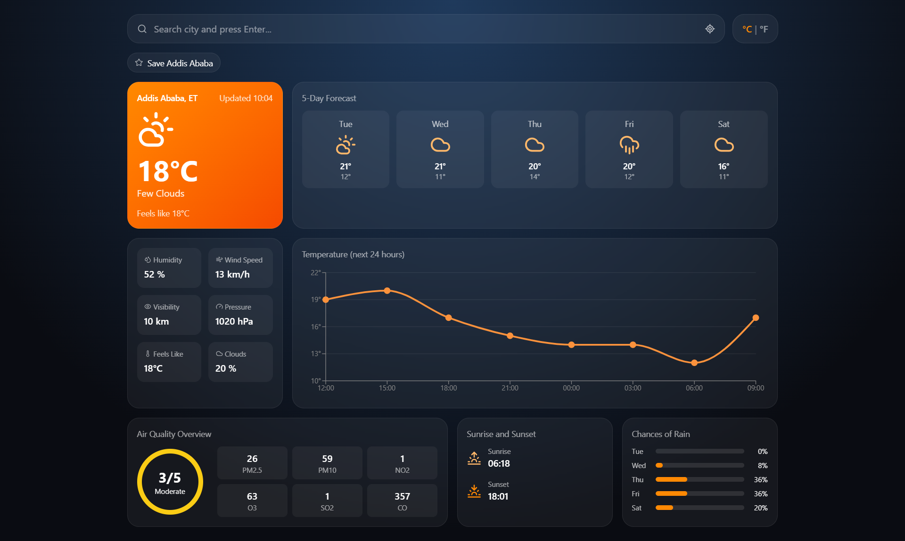
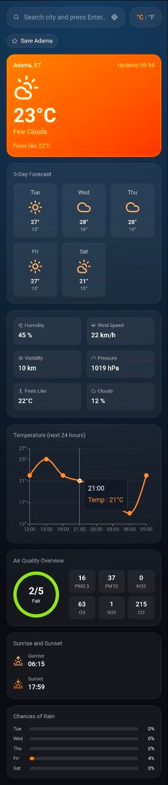

# Weather Dashboard

A responsive, installable weather dashboard with current conditions, a 5-day forecast, hourly temperature chart, air quality, sunrise/sunset, rain probability and weather alerts. Built with React and the OpenWeather API.

**Live demo:** https://weather-dashboard-nine-umber.vercel.app/

  

## Features

- Search any city worldwide, or use your current location
- Current weather, feels like, humidity, wind, visibility, pressure and cloud cover
- 5-day forecast and a 24-hour temperature chart
- Air quality index with pollutant breakdown (PM2.5, PM10, NO2, O3, SO2, CO)
- Sunrise and sunset times in the city's local time zone
- Chance of rain per day
- Weather alerts for strong wind, extreme heat, freezing temperatures, heavy rain and poor air quality
- °C / °F toggle, saved cities, and a background that changes with the weather
- Installable as a PWA (home screen app) with offline support

## Tech Stack

| Area | Tools |
| --- | --- |
| Frontend | React, Vite, Tailwind CSS, Recharts, Lucide icons |
| Data | OpenWeather API (current, forecast, air pollution, geocoding) |
| Backend | Vercel serverless function (API proxy) |
| PWA | Web app manifest and a hand-written service worker |
| Quality | ESLint, GitHub Actions CI |
| Hosting | Vercel (automatic deploys from GitHub) |

## How the API key stays secret

The browser never talks to OpenWeather directly. It calls `/api/owm`, a serverless function that adds the key on the server and forwards the request. The function only allows a fixed list of OpenWeather endpoints. The key lives in an environment variable named `OWM_KEY` (no `VITE_` prefix, so Vite never bundles it into the frontend). Locally, a Vite dev proxy does the same job.

## Getting Started

You need Node.js 20 or newer and a free key from [openweathermap.org](https://openweathermap.org/api).

~~~bash
git clone https://github.com/abukitheunique/weather-dashboard.git
cd weather-dashboard
npm install
~~~

Create a `.env` file in the project root (see `.env.example`):

~~~
OWM_KEY=your_openweather_api_key_here
~~~

Then start the app:

~~~bash
npm run dev
~~~

Open http://localhost:5173. New OpenWeather keys can take up to 2 hours to activate.

## Scripts

| Command | What it does |
| --- | --- |
| `npm run dev` | Start the dev server with the API proxy |
| `npm run build` | Create a production build in `dist/` |
| `npm run preview` | Preview the production build (no API proxy) |
| `npm run lint` | Run ESLint |

## Project Structure

~~~
api/owm.js            Serverless proxy that adds the API key
public/               Manifest, icons and service worker
src/components/       UI cards (forecast, chart, air quality, ...)
src/hooks/            useWeather, useUnit, useSaved, useOnline
src/services/         OpenWeather requests and data shaping
src/utils/            Unit conversion, alerts, theme
~~~

## Deployment

1. Push the repository to GitHub.
2. Import it in [Vercel](https://vercel.com).
3. Add the environment variable `OWM_KEY` under Project Settings, then deploy.

Every push to `main` deploys to production. Pull requests get a preview URL, and GitHub Actions runs lint and build on each push and pull request.

## Install as an app

- **Android (Chrome):** open the site, tap the menu, then **Install app**.
- **iPhone (Safari):** tap Share, then **Add to Home Screen**.

## Notes

- Weather alerts are derived from forecast values because the free OpenWeather plan has no official alerts feed.
- Offline, the app shows the last weather you viewed. Searching a new city needs a connection.

## Author

Built by [abukitheunique](https://github.com/abukitheunique).

